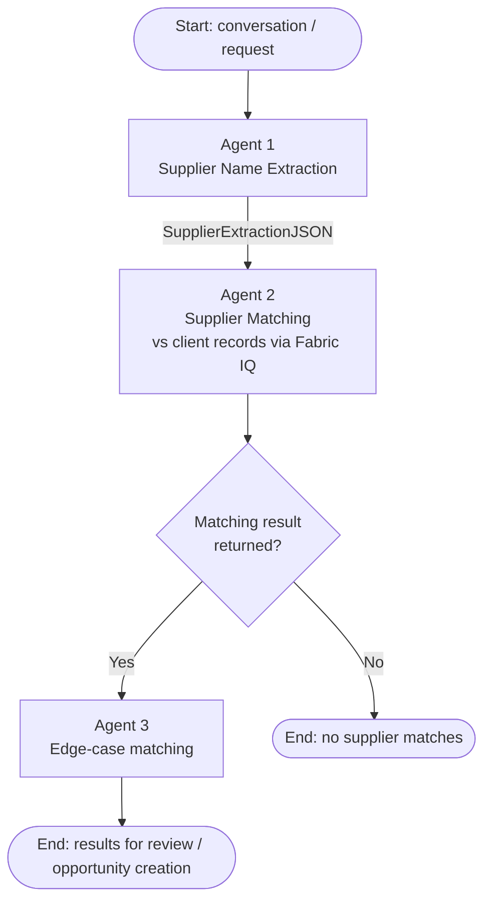
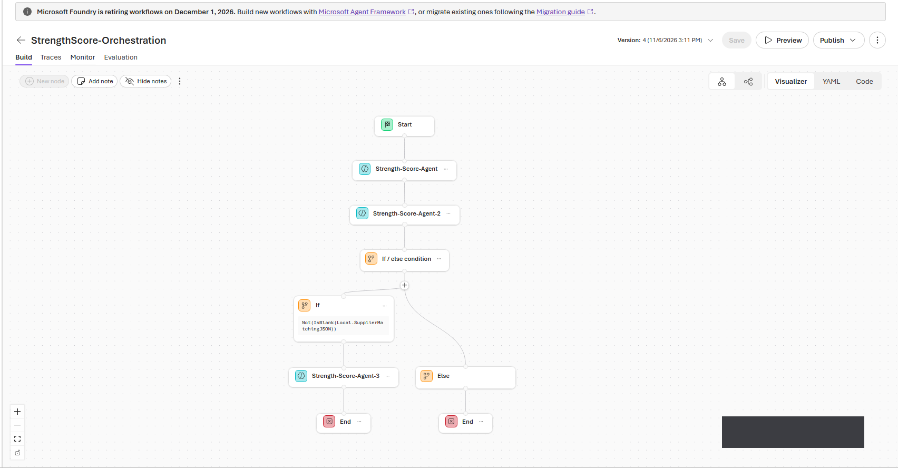
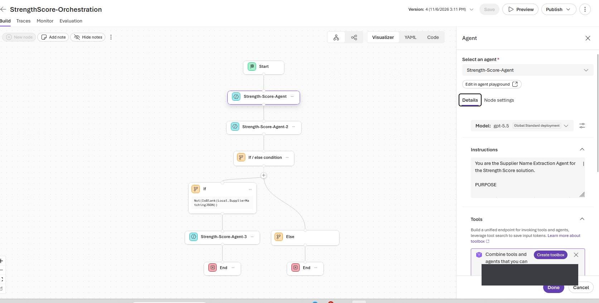
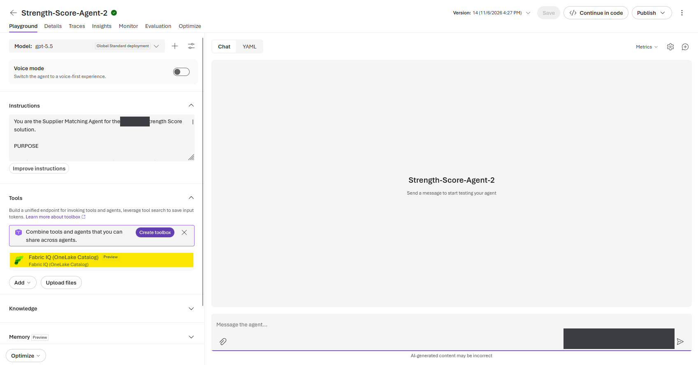

# Strength Score Agent

> A multi-agent workflow built in **Microsoft Foundry** that extracts supplier names from source data, matches them against client records in a **Microsoft Fabric** lakehouse, and flags suppliers who are not yet clients of the bank as candidates for onboarding.

`Microsoft Foundry` · `Foundry Agent Service` · `Multi-agent workflows` · `Fabric IQ` · `OneLake` · `Python` · `YAML`

---

## Overview

Corporate clients of a bank receive payments from many external suppliers and counterparties. Some of those counterparties already bank with the institution; many do not. Each one that does not is a potential new client: a business that is already transacting with the bank's ecosystem but using another provider for its own payments.

The **Strength Score Agent** automates the first part of finding those opportunities. It extracts supplier names from tool or document sources, checks each one against the bank's client records in a Fabric lakehouse, and determines whether the supplier already exists as a client. When a supplier is not matched, the workflow can raise an opportunity for client onboarding, so that relationship teams can approach the supplier about receiving payments through the bank's services.

## Problem and goals

**Problem**
- Identifying which suppliers of existing clients are *not* yet clients is a manual, name-by-name lookup across documents and core client records.
- Supplier names in source data are inconsistent (abbreviations, spelling variants, legal suffixes), so simple lookups miss matches or create false ones.
- Onboarding opportunities hidden in payment flows go unnoticed without a repeatable process.

**Goals**
- Extract supplier names automatically from available sources.
- Match them reliably against governed client data in the lakehouse.
- Separate "already a client" from "potential new client".
- Feed onboarding opportunities to the business in a structured way.

## Solution and workflow

The solution is a Foundry **multi-agent workflow** (`StrengthScore-Orchestration`) that chains three specialised agents:



1. **Supplier extraction (Agent 1).** Reads the incoming message or source content and returns the supplier names it finds as structured JSON (`Local.SupplierExtractionJSON`).
2. **Client matching (Agent 2).** Takes the extracted suppliers and matches them against client records (a `ClientDim` dimension) in the lakehouse. The agent queries governed Fabric data through the **Fabric IQ (OneLake Catalog)** tool. Output: `Local.SupplierMatchingJSON`.
3. **Branching.** A `ConditionGroup` checks whether the matching step returned anything. If not, the workflow ends cleanly.
4. **Edge-case matching (Agent 3).** Resolves the harder cases the first matcher leaves open, for example near-matches and naming variants.
5. **Outcome.** Suppliers confirmed as existing clients are separated from those that are not. Non-clients become candidates for an onboarding opportunity.

Each agent has its own instructions, and all three share one conversation context across the workflow. The extraction and matching agents run on a GPT-5.5 deployment (Global Standard).

## Architecture and technologies

| Component | Technology | Role in this solution |
|---|---|---|
| Orchestration | Microsoft Foundry multi-agent workflow (declarative YAML, versioned) | Chains the three agents, passes JSON between them, branches on results |
| Agents | Foundry Agent Service | Extraction, matching and edge-matching agents, each with dedicated instructions |
| Model | GPT-5.5, Global Standard deployment | Language understanding for extraction and fuzzy name reasoning |
| Data access | Fabric IQ (OneLake Catalog) tool | Lets the matching agent query client data in the lakehouse under Fabric permissions |
| Reference data | Microsoft Fabric lakehouse (`ClientDim`) | Source of truth for existing clients |
| Invocation | Python, `azure-ai-projects` SDK, `DefaultAzureCredential` | Runs the workflow and streams each agent step's output |

**Why this design**
- **Separation of concerns.** Splitting extraction, matching and edge-case handling into separate agents keeps each prompt focused and makes each step testable on its own.
- **Governed data access.** Fabric IQ answers queries under the signed-in user's Fabric permissions, so the agent never needs direct database credentials.
- **Declarative and versioned.** The workflow is defined in YAML and versioned in Foundry (the screenshots show version 4), so changes are traceable.

## Key features

- Three-stage agent pipeline with structured JSON hand-offs.
- Conditional branching that ends early when there is nothing to match.
- A dedicated edge-case matcher for ambiguous supplier names.
- Lakehouse lookups through Fabric IQ, with no embedded credentials.
- Streaming execution trace from Python, showing each workflow action and its status.

## Business value

- **Revenue pipeline:** turns existing payment relationships into a list of onboarding prospects, so the bank can capture counterparties that already transact with its clients.
- **Productivity:** replaces manual, name-by-name lookups with an automated first pass. Relationship teams start from a shortlist instead of raw documents.
- **Consistency:** the same extraction and matching rules apply every time, so results don't depend on who runs the check.

## Screenshots

| Workflow canvas | Extraction agent node |
|---|---|
|  |  |
| The `StrengthScore-Orchestration` workflow in Foundry: three agents and an if/else branch | Agent 1 (Supplier Name Extraction) on GPT-5.5 |

| Matching agent with Fabric IQ |
|---|
|  |
| Agent 2 (Supplier Matching) with the Fabric IQ (OneLake Catalog) tool attached |

## Code samples

| File | Description |
|---|---|
| [`samples/orchestration-workflow.yaml`](samples/orchestration-workflow.yaml) | Declarative workflow definition: three `InvokeAzureAgent` actions and a `ConditionGroup` |
| [`samples/run_workflow.py`](samples/run_workflow.py) | Python client that starts a conversation, runs the workflow, and streams each action's events |

### Running the sample

```bash
pip install "azure-ai-projects>=2.1.0" azure-identity
export FOUNDRY_PROJECT_ENDPOINT="https://<resource>.services.ai.azure.com/api/projects/<project>"
az login
python samples/run_workflow.py
```

You need a Foundry project containing the three agents and the `StrengthScore-Orchestration` workflow. Agent instructions and lakehouse schemas are client-specific and are not included.

## Security, privacy and limitations

- **Authentication:** Microsoft Entra ID via `DefaultAzureCredential`. No keys or secrets in code.
- **Data access:** client lookups go through Fabric IQ, which enforces the caller's Fabric permissions.
- **Human oversight:** the workflow identifies candidates. Decisions about approaching a supplier stay with the business.
- **Confidentiality:** the client name, the endpoints, the agent instructions and all supplier and client data are excluded from this repository.
- **Platform note:** Foundry shows a notice that its workflows feature retires on 1 December 2026, with Microsoft Agent Framework as the recommended path. Moving this workflow to Agent Framework is a natural next step.

## My role

I designed and built the solution end to end: the agent decomposition, the agent instructions, the Foundry workflow, the Fabric IQ integration with lakehouse client data, and the Python invocation client.

---
<sub>Client names, endpoints, identifiers and data have been removed. Screenshots are redacted.</sub>
